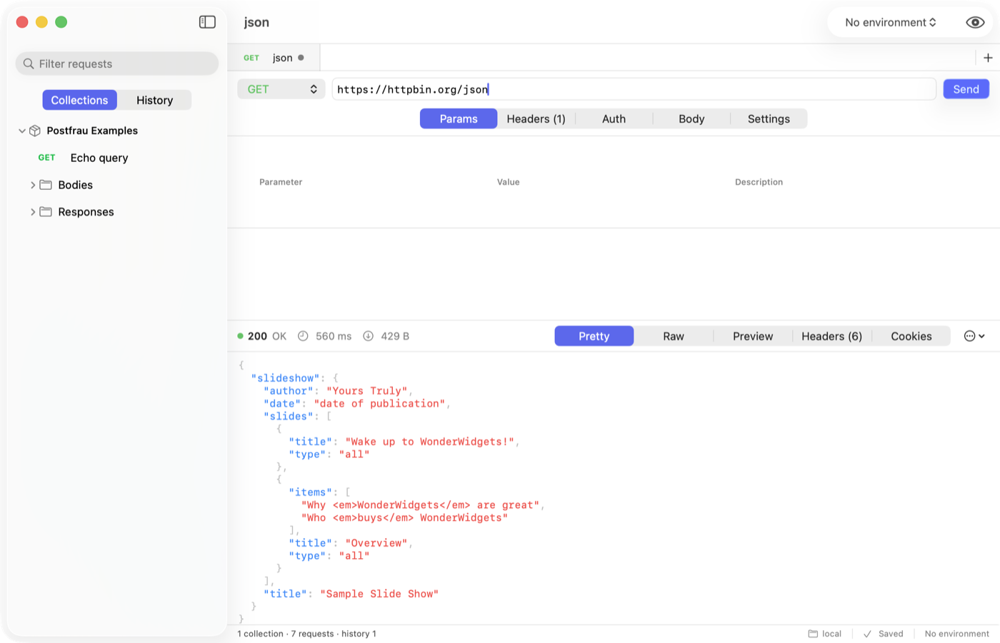

<p align="center">
  
</p>

<h1 align="center">Postfrau</h1>

<p align="center">
  A native HTTP client for macOS 26.<br>
  Your collections are plain JSON files in a folder you choose. No account, no cloud.
</p>

<p align="center">
  <a href="https://github.com/aliaksei-lithium/postfrau/releases/latest"></a>
  
  
</p>



## Install

Download the DMG from [Releases](https://github.com/aliaksei-lithium/postfrau/releases) and drag
Postfrau to Applications. The app is not notarized, so the first time either right-click it and
choose **Open**, or run:

```bash
xattr -dr com.apple.quarantine /Applications/Postfrau.app
```

## Features

- **Local and private.** Collections are files you can sync with iCloud Drive, Dropbox or git.
  Secrets stay in the Keychain.
- **OpenAPI and Postman import.** An OpenAPI 3.x spec (JSON or YAML) becomes a collection you can
  send from right away, and you can update it from a newer spec without losing your edits.
  Postman collections and cURL commands import and export.
- **Environments and history.** Variables and auth are inherited from folders and collections.
  Every send is recorded, with credentials redacted.
- **A command line tool.** `postfrau` can find, run and edit everything the app has, so you can
  script it or hand it to an AI agent.

## Command line

Install it from **Settings ▸ Advanced**.

```bash
postfrau import openapi.yaml                       # add a collection from a spec
postfrau find deposit balance                      # search every request
postfrau run 'Acme API/Users/Get user' --env staging --var user_id=42
postfrau run 'Acme API/Users/List' --param id=1 --param id=2 --dry-run   # what would be sent
postfrau send GET https://api.example.com/health
postfrau history --last 20
```

Overrides such as `--param`, `--body`, `--field`, `-H` and `--auth` change one send without
touching the saved request. `postfrau <command> --help` lists the rest.

**For AI agents:** `postfrau skill install` writes a `SKILL.md` that teaches an agent the
commands. Pass `--as <name>` and the app's history shows which agent sent each request.

## Where your data lives

| What | Where |
|---|---|
| Collections, environments | the folder you choose |
| Secrets | the login Keychain |
| History, settings | the app's container, on this Mac only |

## Not supported

Scripting, test assertions, mock servers, team sync, WebSocket and gRPC.

---

MIT licence · [Building from source](docs/building.md)
